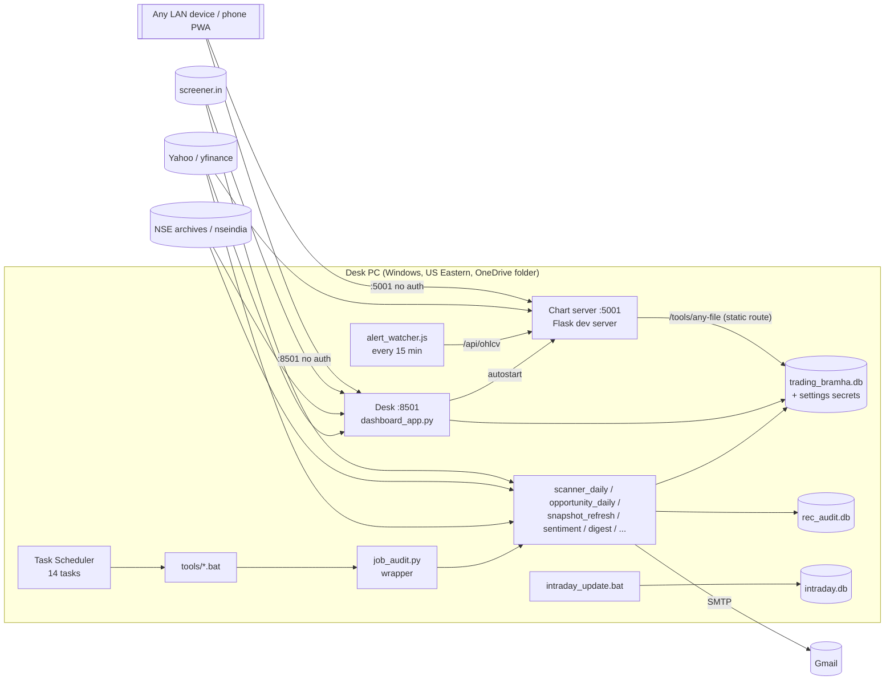
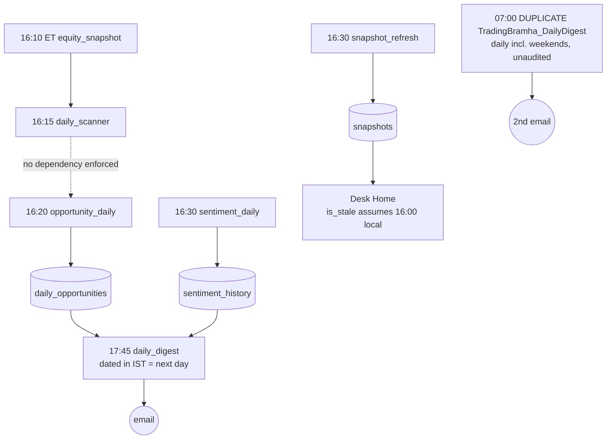

# Trading Bramha — Enterprise Audit

**Date:** 2026-11-23 · **Scope:** Trading_Bramha desk only (`tools/dashboard_app.py` on :8501, `tools/chart_server.py` on :5001, the 14 Windows scheduled jobs, the SQLite stores). SBC_Tool is out of scope.
**Baseline:** branch `feat/pa-pdf-and-yf-breakouts` at `2fa0ba7`, plus uncommitted working-tree edits from another session (`dashboard_app.py`, `desk_pages/__init__.py`, `test_claims_lint.py`, Market Health files). Line numbers are for today's working tree.
**Method:** read-only. I read the code, queried the live Task Scheduler, read `job_runs` and `settings` in `trading_bramha.db` in read-only mode (key names and counts only, never values), compared the two installed Python interpreters, ran `ruff`, used Flask's test client, and sent header-only (`HEAD`) requests to the running chart server. I changed no code.

**Evidence labels**
- **CONFIRMED**: reproduced, or read directly from live state or data.
- **CODE**: follows directly from the cited code; not triggered live.
- **PLAUSIBLE**: depends on a timing or usage condition I could not observe.
- **NEEDS MEASUREMENT**: needs a profiler or a running load. The method is stated.

**Severity:** **S1 Critical** (exposure or loss now) · **S2 High** (wrong data or a missed job is likely) · **S3 Medium** (a real defect with a narrow trigger) · **S4 Low** (hygiene).

## Executive summary

The desk is feature-rich and unusually self-aware: many known traps are documented in the code. But three facts dominate:

1. **Secrets are downloadable on the LAN right now.** The chart server's Flask `static_folder` serves the whole `tools/` directory at `/tools/<file>`, including `trading_bramha.db`. Its `settings` table holds the Gmail app password and the screener.in session cookie in plaintext. Both servers listen on 0.0.0.0. (F-01, F-02: confirmed live.)
2. **The schedulers run on a US-Eastern clock with no NSE calendar.** Jobs work largely because evening ET happens to fall after the NSE close. But staleness rules, dates and holiday handling are wrong in specific, cited ways (F-08, F-10, F-12), and the alert watcher was blind on **41% of runs** (F-07).
3. **The "freshness" signals the operator relies on measure the wrong thing.** The ribbon's batch age is the mtime of a log that desk yfinance errors write to (F-06), and Task Scheduler's "Last result = 0" hides failing runs (F-48).

Full scores, the top 50 findings and the roadmaps are in **Report 10**.

---

## Report 1 — Discovery: Inventory and Environments

### 1.1 Components

| Component | Entry point | Port / trigger | Bind | Notes |
|---|---|---|---|---|
| Desk (Streamlit) | `tools/dashboard_app.py` (11,862 lines) + `tools/desk_pages/*` | :8501 (`start_desk.bat`, `.claude/launch.json` "dashboard") | **0.0.0.0** (netstat, live) | Main daily UI. `:8502` "dashboard-fresh" is the ad-hoc verify copy |
| Chart server (Flask + flask-sock, PWA) | `tools/chart_server.py` (1,891 lines) | :5001; the desk autostarts it (`dashboard_app.py:2760-2797`) | **0.0.0.0** default (`chart_server.py:1884`) | Werkzeug dev server, `threaded=True` (`:1891`). `:5002` "chart-fresh" |
| SBC/astro dashboard (Dash) | `tools/dash_trading_dashboard.py` | :8050 (`start.bat`) | — | Separate app, same repo |
| Breakout scanner (Node) | `tools/breakout_scanner/server.js` | its own `start.bat` | — | Own `node_modules` |
| Legacy Streamlit SBC | `tools/sbc_app.py` | **launched by nothing** (`start_desk.bat` B-84 comment) | — | Dead entry point |
| Scheduled jobs | 14 Windows tasks → `tools/*.bat` → `job_audit.py run …` | See Report 5 | — | Run as `Owner`, LogonType **Interactive**, RunLevel Limited |

### 1.2 Data stores (all SQLite, all inside the OneDrive-synced folder)

| Store | Size | Contents | Writers |
|---|---|---|---|
| `tools/trading_bramha.db` | 65 MB, WAL | positions, watchlists, alerts, **settings (incl. `digest_gmail_app_pw`, `screener_sessionid`)**, snapshots (pickled + zlib), job_runs, opportunities, sentiment, PCR … (21 tables) | desk + ~10 jobs |
| `tools/rec_audit.db` | 36 MB | recommendation audit | `rec_audit_job.py` |
| `tools/intraday.db` | 22 MB | rolling 15m/5m bars | `intraday_store.py` |
| `tools/llm_reads.db`, `reversal_calendar.db` | small | — | — |
| `tools/cache/` | **732 MB** | file caches (largest `cardinality_deep` 202 MB, `multibagger_bars` 81 MB) | many |
| Logs | `tools/pipeline.log` **28 MB**; `tools/logs/*` 4.1 MB | append-only, no rotation | — |

### 1.3 External dependencies
Yahoo Finance via `yfinance`, NSE archives and nseindia endpoints (participant OI, bhavcopy, filings, option chain), screener.in (session cookie read from the browser by `browser_cookie_helper.py`), Gmail SMTP (digest and alerts), Telegram scraping, a Hyperliquid REST API (`data_source.py:416-463`) and a local LLM (`local_llm.py`).

### 1.4 Environments — what does *not* exist
- **No QA or staging.** The only "environments" are the `-fresh` ports (8502/5002) in `launch.json`, used to verify changes next to the live instance.
- **No CI in this repo.** There is no `.github/workflows`; tests run by hand through `run_tests.bat`.
- **No message queue and no microservices.** Jobs coordinate only through the shared SQLite file and fixed clock times. Queue and service-mesh sections of the brief therefore do not apply.
- **No packaging.** No `pyproject.toml`; `tools/requirements_pipeline.txt` and `requirements_dev.txt` give lower bounds only.
- **Two Python interpreters with different libraries (CONFIRMED):**

| Interpreter | Used by | yfinance | streamlit | requests |
|---|---|---|---|---|
| `…\Programs\Python\Python314\python.exe` | desk, chart server (`launch.json`, `start_desk.bat`) | **1.4.1** | 1.58.0 | 2.34.2 |
| `…\Python\pythoncore-3.14-64\python.exe` | **all scheduled `.bat` jobs** | **1.6.0** | 1.57.0 | 2.33.1 |

`requirements_pipeline.txt` requires `streamlit>=1.64.0`, which **neither** interpreter satisfies.

### 1.5 System dependency diagram

---

## Report 2 — Performance (application, API and DB layers)

**Measured:** job wall-clock durations from `job_runs`, 2026-10-23 → 2026-11-23. **Not measured:** desk page latency, chart API p95, memory. Those are marked NEEDS MEASUREMENT, with a method for each.

### 2.1 Measured job durations

| Job | Runs | Avg s | Max s | Note |
|---|---|---|---|---|
| hidden_treasures_daily | 20 | **956** | **3,074** | 51-min worst case |
| snapshot_refresh | 19 | 339 | 658 | |
| daily_scanner | 20 | 280 | 548 | |
| opportunity_daily | 20 | 203 | 444 | |
| rec_audit | 17 | 124 | 511 | |
| filings_watch | 618 | 11 | **1,786** | ≈ its 30-min repeat interval (2026-11-03) |
| others | — | < 30 | < 110 | |

### 2.2 Top 20 performance candidates

| # | Layer | Candidate | Evidence | Status / how to measure |
|---|---|---|---|---|
| P1 | API | One global `threading.Lock` serialises **every** yfinance call in the threaded chart server, so one slow download stalls all charts and the live poller | `data_source.py:150`, `:190-193` | NEEDS MEASUREMENT: `ab -c 4` on `/api/ohlcv` with 4 symbols; compare p95 with c=1 |
| P2 | Job | hidden_treasures_daily averages 16 min, worst 51 min | job_runs | CONFIRMED; profile with `py-spy record -- python tools/hidden_treasures_daily.py` |
| P3 | Job | snapshot_refresh averages 5.6 min and also runs **inside the desk process** at startup (daemon thread) | `dashboard_app.py:2081-2094` | NEEDS MEASUREMENT: `py-spy top --pid <desk>` during a fill |
| P4 | App | Streamlit re-executes the 11,862-line script (303 module-level statements) on every interaction | `test_monolith_ratchet.py:33,44` | NEEDS MEASUREMENT: `python -X importtime`; time reruns with `st.write(time.perf_counter())` probes |
| P5 | App | 61 of 62 `st.cache_data` uses have no `max_entries`; per-symbol keys grow until TTL expiry | grep (only `dashboard_app.py:1930` is bounded) | NEEDS MEASUREMENT: desk RSS over a full session |
| P6 | App | `cached_fetch_sector_data` calls yfinance per sector ticker in a serial loop | `dashboard_app.py:2103-2110` | CODE; batch into one multi-ticker `yf.download` |
| P7 | App | Timeframe board downloads 730 days of hourly bars | `dashboard_app.py:2150-2155` | CODE |
| P8 | App | `period="max"` daily download | `dashboard_app.py:2172` | CODE |
| P9 | API | No negative cache: a dead symbol is retried 3× with backoff on every request (`BAGMANE.NS`: 613 log lines) | `data_source.py:187-200`; `pipeline.log` | CONFIRMED |
| P10 | DB | Snapshots are pickled, zlib-compressed blobs in the hot 65 MB DB with 90-day retention | `snapshot_store.py:41,93-94` | NEEDS MEASUREMENT: `sqlite3_analyzer` per-table size |
| P11 | DB | `trading_bramha.db` is shared by the desk and ~10 jobs; two jobs start at the same minute (16:30) | Task Scheduler | WAL is on; no `database is locked` found in any log. Low |
| P12 | Job | Catch-up stampede: after the PC wakes, every missed task starts in the same second (2026-11-04 19:52:48, 11-06 18:42:00, 11-10 19:04) | job_runs | CONFIRMED; chain or stagger |
| P13 | API | Chart server runs on Werkzeug's dev server (`app.run`) for a LAN PWA | `chart_server.py:1891` | CODE; use waitress |
| P14 | Job | filings_watch worst run ≈ its 30-min interval, so the next run is skipped (`IgnoreNew`) | job_runs | CONFIRMED once |
| P15 | I/O | The desk writes every yfinance error to the 28 MB `pipeline.log` on the render path | `screener_pipeline.py:106-110` | CODE |
| P16 | I/O | 732 MB `tools/cache` plus live DB WAL files sit in OneDrive, so every write triggers a sync | `du` | NEEDS MEASUREMENT: OneDrive activity during 16:10–17:45 ET |
| P17 | API | The live poller fetches yfinance per subscribed symbol under the same lock as P1 | `chart_server.py:287-331` | NEEDS MEASUREMENT |
| P18 | App | 82 raw-HTML renders (ratchet ceiling) | `test_monolith_ratchet.py:45` | NEEDS MEASUREMENT: browser Performance panel on Home |
| P19 | Job | alert_watcher runs 96 times a day; most runs gate out as "session closed" | job_runs results | CONFIRMED; cheap (~2 s) but noisy |
| P20 | App | yfinance 1.4.1 (desk) vs 1.6.0 (jobs): the same symbol can come back differently live vs in a snapshot | Report 1.4 | Versions CONFIRMED; behavioural diff NEEDS MEASUREMENT |

---

## Report 3 — Codebase Cleanup

### 3.1 Dead Code Register

| Item | Why it is dead | Evidence | Action |
|---|---|---|---|
| `tools/sbc_app.py` | "launched by nothing" | `start_desk.bat` B-84 comment; orphan scan | Archive |
| `tools/install_task.ps1` | Registers `Trading_Screener_Pipeline` (not present), path `C:\Users\dhara\…`, "4:05 PM after NSE close" (wrong on an ET clock) | file; Task Scheduler | Delete |
| `screener_pipeline.py` as a scheduled pipeline | Its task is gone, but importing it still configures root logging (F-06) | `screener_pipeline.py:106-110` | Move logging setup under `if __name__ == "__main__"` |
| 13 non-research modules referenced by no other module or `.bat` | `capture_ew_fixture, confluence_scoring, contra_inflection, health_check, multibagger_bars_fetch, own_history_valuation, planet_positions, portfolio_risk_monitor, progress_tracker, qm_deep_cache, sbc_abhijit, sbc_app, swing_screener` | Text-match import scan (may miss by-hand CLI use) | Verify, then archive |
| Research one-offs (`*_study.py`, `*_backtest.py`, probes) | 9 entirely unreferenced; many more referenced only by their tests | scan | Move to `research/` |
| `tools/demo_*.xlsx`, `swing_pipeline.log` (0 bytes since 2026-06), `streamlit_run.log` (2026-06) | Stale artefacts | `ls` | Delete |
| Unused imports / variables | 143 F401, 42 F841, 6 F811 (incl. `dashboard_app.py:1955` shadowing `help`) | `ruff --statistics` | `ruff --fix` for F401/F841 |
| `astro_trading._ephem_to_datetime` | Always raises NameError | `astro_trading.py:296-299` | Fix the import or delete |
| Sign-in control | "kept so a future per-page gate has something to read" | `dashboard_app.py:895-899` | Wire it to write paths, or remove it with its default password |

### 3.2 Technical Debt Heat Map

Scale: 🟥 high · 🟧 medium · 🟨 low · ⬜ n/a

| Module | Size | Error handling | Time / calendar | Security | Tests | Coupling |
|---|---|---|---|---|---|---|
| `dashboard_app.py` | 🟥 11,862 lines | 🟧 12 silent (ratcheted) | 🟧 holiday-unaware ribbon | 🟥 unauth writes, schtasks | 🟨 | 🟥 imports `screener_pipeline` for a log path |
| `chart_server.py` | 🟧 1,891 | 🟧 int parsing | 🟨 | 🟥 static `tools/` | 🟨 CORS/route tests exist | 🟧 global yf lock |
| `snapshot_store.py` | 🟨 | 🟨 good | 🟥 16:00 local close; local-date key | 🟧 pickle | 🟨 | 🟨 |
| `job_audit.py` | 🟨 | 🟨 never fails the job | 🟧 naive time, DST | ⬜ | 🟨 | 🟨 |
| `daily_digest_email.py` | 🟨 | 🟨 | 🟧 IST/ET bridging | 🟥 stores app password | 🟨 | 🟧 reads three jobs' outputs |
| `data_source.py` | 🟨 | 🟧 `[]` on failure | 🟨 | ⬜ | 🟨 | 🟧 |
| `alert_watcher.js` | 🟨 | 🟨 BLIND exit 2 (good) | 🟧 no holidays | ⬜ | 🟨 | 🟥 needs chart server |
| `.bat` jobs (14) | 🟨 | 🟨 | 🟧 ET clock | ⬜ | ⬜ | 🟧 hard-coded interpreter |
| `astro_trading.py` | 🟨 | 🟥 NameError | 🟨 | ⬜ | 🟧 | 🟨 |

---

## Report 4 — Workflow Integrity (0–100 per workflow)

Rubric: correctness, failure visibility, idempotency, calendar/timezone safety, recoverability (20 points each). These are judgement scores, not measurements.

| # | Workflow | Score | Main deductions |
|---|---|---|---|
| W1 | EOD scan → opportunity shortlist → digest | **55** | Digest duplicated and not idempotent (F-05); IST/ET dates bridged by special-case code (`daily_digest_email.py:127-145`); runs on holidays |
| W2 | Snapshot refresh → Home render | **50** | Staleness uses a 16:00 *local* close (F-08); same-date overwrite (F-09); ribbon age reads the wrong log (F-06) |
| W3 | Intraday alerts (alert_watcher → chart server) | **35** | Blind on 41% of runs (F-07); depends on an unsupervised process |
| W4 | Filings watch | **75** | Solid; one interval overrun |
| W5 | Chart view (desk → chart server → yfinance) | **60** | `[]` for both "no data" and "fetch failed" (F-17); global lock (P1) |
| W6 | Monthly recommendation audit | **75** | Well instrumented; runs on the jobs interpreter (yfinance 1.6) |
| W7 | Intraday bar store top-up | **55** | Not wrapped in job_audit; `StartWhenAvailable=False`; a missed day is unrecoverable by design (F-13) |
| W8 | Portfolio / watchlist / alert CRUD | **55** | Works, but any LAN device can call it (F-03) |
| W9 | Equity snapshot | **75** | Holiday-safe by design ("re-writes the last session", `equity_snapshot.py:6`) |

Mean: **59**.

---

## Report 5 — Scheduler Integrity

### 5.1 Inventory (live Task Scheduler; machine time zone = **Eastern, with DST**)

| Task | Trigger (ET) | IST equivalent (EST / EDT) | In job_audit? | StartWhenAvail |
|---|---|---|---|---|
| TradingBramha-AlertWatcher | every 15 min, all 7 days | — (gated to the IST session in code) | yes | yes |
| TradingBramha-FilingsWatch | every 30 min, Mon–Fri | — | yes | yes |
| TradingBramha-IntradayUpdate | 07:00 **daily** | 17:30 / 16:30 | **no** | **no** |
| **TradingBramha_DailyDigest** (underscore) | 07:00 **daily**, StartBoundary pinned to **-05:00** | 17:30 | **no** (calls python directly) | yes |
| TradingBramha-DmaWatch | 08:00 Mon–Fri | 18:30 / 17:30 | yes | yes |
| TradingBramha-EquitySnapshot | 16:10 Mon–Fri | 02:40 / 01:40 next day | yes | yes |
| TradingBramha-DailyScanner | 16:15 Mon–Fri | 02:45 / 01:45 | yes | yes |
| TradingBramha-OpportunityDaily | 16:20 Mon–Fri | 02:50 / 01:50 | yes | yes |
| TradingBramha-SentimentDaily | 16:30 Mon–Fri | 03:00 / 02:00 | yes | yes |
| TradingBramha-SnapshotRefresh | 16:30 Mon–Fri | 03:00 / 02:00 | yes | yes |
| TradingBramha-HiddenTreasuresDaily | 16:45 Mon–Fri | 03:15 / 02:15 | yes | yes |
| TradingBramha-GrowthSnapshot | 17:10 Mon–Fri | 03:40 / 02:40 | yes | yes |
| TradingBramha-RecAudit | 17:30 Mon–Fri | 04:00 / 03:00 | yes | yes |
| TradingBramha-DailyDigest (hyphen) | 17:45 Mon–Fri | 04:15 / 03:15 | yes | yes |

All tasks report `LastTaskResult = 0`, yet 813 alert_watcher runs in the period exited 2 (BLIND). **Task Scheduler's "Last result" is not a health signal.**
All tasks: LogonType **Interactive** (they run only while `Owner` is logged on), `WakeToRun=False`, `ExecutionTimeLimit=PT72H` (the underscore digest PT1H), `MultipleInstances=IgnoreNew`, `RestartCount=0`.

### 5.2 Dependency chains
None is enforced. Order comes only from 5–15-minute clock offsets. `daily_scanner` averages 280 s and can take 548 s, so it can still be running when `opportunity_daily` starts at +5 min. On catch-up days both start in the same second (recorded on 3 days). The digest reads the opportunity shortlist and sentiment, and assumes both finished by 17:45.

### 5.3 Edge cases

| Edge case | What happens today | Evidence | Status |
|---|---|---|---|
| **NSE holiday** | All Mon–Fri jobs run and recompute the previous session; the desk ribbon shows "LIVE" on a holiday; alert_watcher gates on weekday only | `dashboard_app.py:1160` ("this repo has no exchange holiday calendar"); `alert_watcher.js:57-62` | CODE |
| **Saturday / Muhurat special session** | No Mon–Fri ET trigger covers a Saturday IST session, and alert_watcher rejects Saturday | `alert_watcher.js:61` | CODE |
| **DST fall-back** (01:00–02:00 ET repeats) | `job_runs` is `UNIQUE(job_id, started_at)` on naive local time with `INSERT OR IGNORE`, so the second 01:15 run is silently dropped from history | `job_audit.py:65,82-83,129` | CODE |
| **DST spring-forward** | 02:00–03:00 ET does not exist; Task Scheduler skips it (affects alert_watcher only, outside the IST session) | — | Low |
| **DST and the pinned digest** | Underscore digest StartBoundary `07:00-05:00` fires at 08:00 local in summer | Task definition | PLAUSIBLE |
| **IST date ≠ ET date** | Evening ET jobs run on the next IST day. The digest dates itself in IST, so the Friday 2026-11-20 run reported "digest for 2026-11-21" (a Saturday) | `logs/daily_digest.log`; `daily_digest_email.py:45,704` | CONFIRMED |
| **PC asleep / restarted** | `StartWhenAvailable` catches up, but every job fires at once; IntradayUpdate has no catch-up and loses rolling 15m data | job_runs; `intraday_update.bat` header | CONFIRMED |
| **User logged off** | Interactive LogonType: nothing runs | Task principal | CODE |
| **Hung job** | No timeout in `job_audit.run_wrapped` and no "running" row at start; the task holds for up to 72 h and `IgnoreNew` silently skips later triggers | `job_audit.py:144-178` | CODE |
| **Month / quarter / year end** | `rec_audit` names monthly files by run date (`reports/audit/2026-11.md`); the last ET run of a month can fall on the first IST day of the next month. Nothing is scheduled quarterly or yearly; no year-end handling exists or appears needed | `reports/audit/*` | PLAUSIBLE (month boundary) |
| **Hub "Save schedule"** | Rewrites the tracked `scanner_daily.bat` and re-registers with `/sc DAILY /rl HIGHEST`, replacing the Mon–Fri trigger; its help text "16:15 = 15 min after NSE close" is wrong on an ET clock | `dashboard_app.py:7667-7670,7711-7742` | CODE |

### 5.4 Scheduler Risk Matrix

| Likelihood ↓ / Impact → | Low | Medium | High |
|---|---|---|---|
| **High** | alert_watcher noise runs (P19) | holiday runs (F-10); IST/ET date skew (F-12) | **alert_watcher blind (F-07)**; **duplicate digest (F-05)** |
| **Medium** | spring-forward skip | catch-up stampede (P12); scanner→opportunity race (F-14) | staleness wrong for ~11 h a day (F-08) |
| **Low** | pinned -05:00 boundary (F-49) | DST fall-back history loss (F-15) | hung job blocks for 72 h (F-16); Hub re-save flips to DAILY (F-11b) |

```mermaid
gantt
  title Weekday schedule in ET, with the NSE session (EST)
  dateFormat HH:mm
  axisFormat %H:%M
  section NSE (prev. evening ET)
  NSE session 22:45-05:00 ET :crit, 00:00, 5h
  section Morning ET
  IntradayUpdate + duplicate digest :07:00, 10m
  DmaWatch :08:00, 5m
  section Evening chain ET
  EquitySnapshot :16:10, 2m
  DailyScanner :16:15, 9m
  OpportunityDaily :16:20, 7m
  Sentiment + SnapshotRefresh :16:30, 11m
  HiddenTreasures (worst case) :16:45, 51m
  GrowthSnapshot :17:10, 2m
  RecAudit :17:30, 8m
  DailyDigest :17:45, 2m
```

---

## Report 6 — End-to-End Validation

### 6.1 Idempotency

| Operation | Idempotent? | Evidence |
|---|---|---|
| `snapshot_store.save` | Per (name, *local* date): DELETE then INSERT. Same-date re-runs are safe, but a refresh during the IST session (22:45–05:00 ET) **replaces the previous EOD row with intraday data under the same date** | `snapshot_store.py:121-133`. PLAUSIBLE (manual refresh in that window) |
| `snapshot_store.save_error` | Good: keeps an existing ok row | `snapshot_store.py:145-167` |
| `daily_digest_email.main` | **No**: no sent-marker, and two tasks call it, so two emails | `daily_digest_email.py:686-715` |
| `job_audit.record` | `INSERT OR IGNORE`: idempotent, but loses rows on DST fall-back | `job_audit.py:129` |
| `participant_oi.fetch` | A 404 writes a permanent `.none` marker, so a late or transient 404 is never retried | `participant_oi.py:96-98`. PLAUSIBLE |
| `equity_snapshot` | Holiday-safe by design | `equity_snapshot.py:6` |

### 6.2 Silent failures

| # | Where | Why it is silent |
|---|---|---|
| 1 | `YFinanceSource.get_ohlcv` | Returns `[]` for "no data", "missing columns" and "3 failed tries" alike (`data_source.py:203-209`) |
| 2 | Ribbon "batch X ago" | Reads `pipeline.log` mtime (`dashboard_app.py:1182-1202`, rendered at `:1319`). That log moves whenever the desk logs a yfinance error, because `screener_pipeline.py:106-110` installs a root `FileHandler` at import. The screener pipeline is no longer scheduled. Today the ribbon would have read 10:32 ET, the time of a `BAGMANE.NS` error |
| 3 | Task Scheduler "Last result" | 0 while alert_watcher was failing (5.1) |
| 4 | Underscore digest and IntradayUpdate | Bypass `job_audit`, so they never appear in Scheduler Hub history |
| 5 | 417 `except Exception:` handlers (84 followed by `pass`) in non-test code | grep; the ratchet covers only `dashboard_app.py` (12 silent handlers) |
| 6 | `astro_trading.py:298` | `ephem.Date` → NameError (only `Sun, Moon, …, Observer` are imported at `:18`); called at `:258-259` |
| 7 | Snapshot startup fill | Runs in a daemon thread inside the desk; its failures reach no UI (`dashboard_app.py:2081-2100`, outer `try/except: pass`) |

### 6.3 Single points of failure

| SPOF | Blast radius |
|---|---|
| Chart server process (started only by the desk) | alert_watcher goes blind; charts and the PWA break |
| The desk PC: logged on, awake, online | Every job (Interactive LogonType, no WakeToRun) |
| `trading_bramha.db` (one file, no backup, in OneDrive) | Portfolio, settings/secrets, snapshots, job history |
| Yahoo Finance | Nearly every price path; no second price source for NSE equities |
| The `pythoncore-3.14-64` path hard-coded in 14 `.bat` files | All jobs (`intraday_update.bat`'s header records an earlier interpreter-path outage) |

---

## Report 7 — Observability

| Capability | State | Evidence |
|---|---|---|
| Run history | **Good.** `job_runs` stores duration, exit code, the `##RESULT` line and a failure tail | `job_audit.py` |
| Run-history coverage | 12 of 14 tasks | 5.1 |
| Failure alerting | **None** for jobs; only alert_watcher emails, once a day, when blind (`alert_watcher.js:13-16`) | — |
| Health endpoints | None on the desk or the chart server | grep |
| Log rotation | None; `job_audit.py` docstring says logs "grow without limit and get truncated by hand" | 28 MB `pipeline.log` |
| Structured logs | `structured_logger.py` exists, but the main paths use plain `logging.basicConfig` text | — |
| Freshness on the UI | Per-snapshot badge plus the ribbon; both have defects (F-06, F-08) | — |
| Metrics / tracing | None. Not expected at this scale; latency claims need measurement | — |

---

## Report 8 — Security (auth, secrets, chart server CORS, API)

| ID | Finding | Evidence | Status | Sev |
|---|---|---|---|---|
| F-01 | **The chart server serves the whole `tools/` directory** at `/tools/<path>`. `Flask(__name__, static_folder=str(HERE))` registers Flask's built-in static route, so `/tools/trading_bramha.db`, `/tools/rec_audit.db` and every `.py`, `.json` and cache file can be downloaded. This contradicts the B-86 rationale, which says the server uses "a module route that serves only what the page references … rather than anything in `tools/`" | `chart_server.py:45`, `:1880-1883`; Flask test client shows rule `/tools/<path:filename>`; live `HEAD http://127.0.0.1:5001/tools/trading_bramha.db` → **200** | **CONFIRMED** | **S1** |
| F-02 | **Plaintext secrets in that DB.** `settings` holds `digest_gmail_app_pw` and `screener_sessionid`, both non-empty, written by `configure_credentials` | `daily_digest_email.py:68-69`; read-only key query | **CONFIRMED** | **S1** |
| F-03 | **The desk has no auth and listens on 0.0.0.0:8501.** Signing in "unlocks NOTHING", yet the desk can add or delete positions, watchlists and alerts, delete scanner runs, spawn processes, and **create or delete Windows scheduled tasks at RunLevel HIGHEST** | `dashboard_app.py:891-905`, `:2791`, `:7736-7770`; netstat | CONFIRMED (bind); CODE (actions) | **S1** |
| F-04 | **Default credential in source and in a public repo.** `_auth_check` falls back to a hard-coded password. `tools/.streamlit/secrets.toml` is tracked in **public** `kalyandhara/TradingBramhaTool` and holds the same value as both the local secrets and the code default | `dashboard_app.py:903-904`; `git ls-files`; `gh repo view` → PUBLIC | CONFIRMED (values compared, not printed) | S2 (it gates nothing today) |
| F-44 | The accepted B-86 risk (LAN bind for the PWA) relies on "no credentials, no writes"; F-01 and F-02 make that premise false | `chart_server.py:1870-1883` | CONFIRMED | S2 |
| F-36 | Snapshots are `pickle.loads` of DB blobs, so anyone who can write the DB gets code execution in the desk | `snapshot_store.py:93-99` | CODE | S3 |
| F-35 | `browser_cookie_helper.py` reads the browser cookie store for screener.in. Legitimate, but it puts a live session token in the DB (F-02) | file header | CODE | S4 |
| F-30 | Unvalidated `int(request.args…)` returns a 500 on bad input across ~15 routes | `chart_server.py:567,600,708,…` | CODE | S4 |
| — | **CORS is scoped correctly**: only `/api/ohlcv`, only for origins :8501/:8502. CORS does not mitigate F-01, which needs no browser | `chart_server.py:52-61` | CONFIRMED | positive |

**API security summary:** both HTTP surfaces are unauthenticated, plain HTTP and bound to every interface. The chart server's "read-only" claim holds for its `/api/*` routes, but not for its static route.

---

## Report 9 — Enhancement Discovery

| # | Enhancement | Value | Effort |
|---|---|---|---|
| E1 | `nse_calendar.py`: one holiday and special-session calendar (data file refreshed yearly, with a test that fails when next year is missing), used by jobs, alert_watcher, `_market_status` and `is_stale` | No holiday runs or false LIVE states | M |
| E2 | One clock module, `now_ist()` / `session_date()`; jobs key data on the **NSE session date**, never the machine date | Removes the IST/ET special cases | M |
| E3 | Run the chart server and desk as supervised services (NSSM/WinSW, or a run-whether-logged-on task), loopback by default, with PWA/LAN mode opt-in | Fixes blind alerts and the SPOF | S |
| E4 | Windows Credential Manager (`keyring`) for SMTP and screener secrets | Secrets out of the DB | S |
| E5 | Explicit job chain: one `eod_chain.bat` running scanner → opportunity → snapshot → digest in sequence | No races, no stampede | S |
| E6 | `job_audit` writes a "running" row at start, enforces a per-job timeout, and stores UTC | Hung-job visibility; DST-safe | S |
| E7 | Failure notification: one email or Telegram message per failed job per day, from `job_audit` | Observability | S |
| E8 | Nightly `sqlite3 .backup` of the three DBs to a non-OneDrive folder, plus a restore drill | Recoverability | S |
| E9 | One interpreter and a `requirements.lock` for desk and jobs | Ends yfinance 1.4.1 / 1.6.0 drift | S |
| E10 | GitHub Actions on this repo: ruff plus the fast test subset | Catches F541/claims-lint breaks before merge | S |

---

## Report 10 — Executive Reporting

### 10.1 Executive scores

| Dimension | Score /100 | Basis |
|---|---|---|
| Security | **20** | Secrets downloadable on the LAN; no working auth gate (F-01–F-04) |
| Scheduler integrity | **45** | No holiday calendar, duplicate digest, 41% blind alert job, no timeouts, DST gaps (F-05, F-07, F-10–F-16) |
| Data freshness / correctness | **50** | Freshness indicators measure the wrong things (F-06, F-08, F-09) |
| Observability | **55** | `job_audit` is genuinely good; no failure notification, health endpoints or log rotation |
| Workflow integrity | **59** | Mean of the 9 workflows in Report 4 |
| Code health | **50** | Monolith 38 lines under its ratchet; 417 broad excepts; 1 live NameError; two interpreters |
| Environments / delivery | **30** | One PC, no QA/staging, no CI, no backups |
| Performance | **not scored** | Job durations measured; interactive latency NEEDS MEASUREMENT (Report 2) |

> These are rubric judgements (correctness, failure visibility, idempotency, calendar/timezone safety, recoverability), not measured metrics.

### 10.2 Top 50 findings (ranked)

| # | ID | Sev | Finding | Evidence | Status |
|---|---|---|---|---|---|
| 1 | F-01 | S1 | Chart server static route exposes all of `tools/` (DBs, source, caches) on 0.0.0.0:5001 | `chart_server.py:45`; live HEAD 200 | CONFIRMED |
| 2 | F-02 | S1 | Gmail app password and screener session cookie stored in plaintext in the exposed DB | `daily_digest_email.py:68-69` | CONFIRMED |
| 3 | F-03 | S1 | Desk on 0.0.0.0:8501 with no auth can change the portfolio and register or delete scheduled tasks at HIGHEST | `dashboard_app.py:891-905,7736-7770` | CONFIRMED / CODE |
| 4 | F-05 | S2 | Two digest tasks: the underscore one runs daily including weekends, unaudited; no idempotency, so duplicate emails with different dates | Task Scheduler; `daily_digest_email.py:686-715` | CONFIRMED |
| 5 | F-07 | S2 | alert_watcher blind on 813 of 1,965 runs (41%) since 2026-10-23, including whole days (11-10, 11-11, 11-14) | job_runs | CONFIRMED |
| 6 | F-06 | S2 | Ribbon "batch age" measures `pipeline.log` mtime, which desk yfinance errors move | `dashboard_app.py:1182-1202`; `screener_pipeline.py:106-110` | CONFIRMED |
| 7 | F-08 | S2 | `is_stale` assumes a 16:00 local close; on ET, a snapshot reads fresh for ~11 h after a new NSE close | `snapshot_store.py:290-310` | CODE |
| 8 | F-10 | S2 | No NSE holiday or special-session calendar anywhere | `dashboard_app.py:1160` | CONFIRMED |
| 9 | F-04 | S2 | Default desk password hard-coded and committed to a public repo | `dashboard_app.py:903-904`; tracked `tools/.streamlit/secrets.toml` | CONFIRMED |
| 10 | F-11 | S2 | Two interpreters: jobs on yfinance 1.6.0, desk on 1.4.1; `streamlit>=1.64` unmet by both | pip list | CONFIRMED |
| 11 | F-16 | S2 | No job timeout and no start row: a hang blocks a task for up to 72 h, silently | `job_audit.py:144-178`; PT72H + IgnoreNew | CODE |
| 12 | F-26 | S2 | No backups of the three live SQLite DBs, which sit in OneDrive sync | `du`; no backup code | CONFIRMED |
| 13 | F-44 | S2 | Accepted B-86 LAN risk rests on a false premise | `chart_server.py:1870-1883` | CONFIRMED |
| 14 | F-09 | S3 | Same-date DELETE+INSERT lets an in-session refresh overwrite the prior EOD snapshot | `snapshot_store.py:121-133` | PLAUSIBLE |
| 15 | F-13 | S3 | IntradayUpdate is unaudited with `StartWhenAvailable=False`; a missed day of 15m bars is unrecoverable | Task; `intraday_update.bat` | CONFIRMED |
| 16 | F-14 | S3 | No enforced job chain; scanner and opportunity overlapped on 3 catch-up days | job_runs | CONFIRMED |
| 17 | F-12 | S3 | Mixed clocks: the digest is dated in IST (Friday run → "2026-11-21", a Saturday); other jobs use ET dates | `logs/daily_digest.log`; `daily_digest_email.py:127-145` | CONFIRMED |
| 18 | F-11b | S3 | Hub "Save schedule" re-registers DailyScanner as `/sc DAILY /rl HIGHEST` and rewrites a tracked `.bat` | `dashboard_app.py:7711-7742` | CODE |
| 19 | F-11c | S3 | Hub help text "16:15 = 15 min after NSE close" is wrong on an ET clock | `dashboard_app.py:7667-7670` | CODE |
| 20 | F-15 | S3 | DST fall-back: `INSERT OR IGNORE` on naive local `started_at` drops repeated-hour runs | `job_audit.py:65,82,129` | CODE |
| 21 | F-17 | S3 | `get_ohlcv` returns `[]` for both no-data and fetch failure | `data_source.py:203-209` | CODE |
| 22 | P1 | S3 | Global yfinance lock serialises the threaded chart server | `data_source.py:150` | CODE / NEEDS MEASUREMENT |
| 23 | F-19 | S3 | participant_oi caches a 404 forever (`.none`) | `participant_oi.py:96-98` | PLAUSIBLE |
| 24 | F-18 | S3 | No negative cache for dead symbols (`BAGMANE.NS` ×613 log lines) | `pipeline.log` | CONFIRMED |
| 25 | F-22 | S3 | `astro_trading.py:298` NameError on `ephem` | ruff F821 | CONFIRMED (static) |
| 26 | F-36 | S3 | Pickle deserialisation of DB blobs | `snapshot_store.py:93-99` | CODE |
| 27 | F-38 | S3 | No failure notification for 13 of 14 jobs | — | CONFIRMED |
| 28 | F-14b | S3 | Interactive LogonType and no WakeToRun: logged off or asleep means no jobs | Task principal | CONFIRMED |
| 29 | F-21 | S3 | 417 `except Exception:` (84 `pass`) outside the ratcheted file | grep | CONFIRMED |
| 30 | P2 | S3 | hidden_treasures_daily averages 956 s, max 3,074 s | job_runs | CONFIRMED |
| 31 | F-20 | S4 | `dashboard_app.py` is 11,862 lines against a ratchet of 11,900 (38 left) | `test_monolith_ratchet.py:33` | CONFIRMED |
| 32 | F-23 | S4 | ruff: 143 F401, 42 F841, 27 F541 (incl. `desk_pages/home_layout.py:518`), 6 F811 | ruff | CONFIRMED |
| 33 | F-24 | S4 | `test_claims_lint::test_the_index_is_self_consistent` is failing (the working tree carries another session's edits) | reported by the requesting session; not re-run here | REPORTED |
| 34 | F-25 | S4 | Unrotated logs (28 MB `pipeline.log`) | `ls` | CONFIRMED |
| 35 | F-42 | S4 | No CI workflows in this repo | no `.github/` | CONFIRMED |
| 36 | P5 | S4 | 61 of 62 `cache_data` uses have no `max_entries` | grep | NEEDS MEASUREMENT |
| 37 | P3 | S4 | Snapshot startup fill runs inside the desk process | `dashboard_app.py:2081-2094` | NEEDS MEASUREMENT |
| 38 | P13 | S4 | Werkzeug dev server for a LAN PWA | `chart_server.py:1891` | CODE |
| 39 | F-30 | S4 | `int()` on query params → 500 | `chart_server.py:567,600,…` | CODE |
| 40 | P12 | S4 | Catch-up stampede after wake | job_runs | CONFIRMED |
| 41 | P14 | S4 | filings_watch run ≈ its interval (1,786 s) | job_runs | CONFIRMED |
| 42 | F-39 | S4 | No health endpoints | grep | CONFIRMED |
| 43 | F-45 | S4 | `install_task.ps1` is stale (wrong user path, unregistered task) | file | CONFIRMED |
| 44 | F-46 | S4 | `sbc_app.py` is launched by nothing | `start_desk.bat` | CONFIRMED |
| 45 | F-47 | S4 | 13 orphan non-research modules | scan | CODE (verify) |
| 46 | F-48 | S4 | Task "Last result = 0" hides failing runs | 5.1 | CONFIRMED |
| 47 | F-49 | S4 | Underscore digest StartBoundary pinned to `-05:00` shifts to 08:00 in EDT | Task definition | PLAUSIBLE |
| 48 | F-50 | S4 | Month end: the last ET run of a month can fall on the first IST day of the next | `rec_audit` file naming | PLAUSIBLE |
| 49 | P16 | S4 | 732 MB cache plus live WALs inside OneDrive | `du` | NEEDS MEASUREMENT |
| 50 | F-35 | S4 | Browser-cookie scraping puts a live session token in app storage | `browser_cookie_helper.py` | CODE |

### 10.3 Roadmaps

**Quick wins (this week, each under a day)**
1. Rotate the Gmail app password; sign out of screener.in to invalidate the cookie (F-02).
2. Chart server: drop `static_folder=str(HERE)` (pass `static_folder=None`; the explicit routes already serve what the page needs) and default `--host 127.0.0.1` with an opt-in PWA flag. Add a test that `GET /tools/trading_bramha.db` returns 404 (F-01, F-44).
3. Unregister `TradingBramha_DailyDigest` (underscore) and add a "sent for session date X" check in `daily_digest_email.main` (F-05).
4. Set `server.address = "127.0.0.1"` in `.streamlit/config.toml` unless LAN use is wanted (F-03).
5. Remove the hard-coded default password and untrack `tools/.streamlit/secrets.toml` (F-04).
6. Point the ribbon at `job_runs` (latest `daily_scanner`/`snapshot_refresh` row) instead of `pipeline.log`; move `basicConfig` under `__main__` (F-06).
7. Wrap `intraday_update.bat` in `job_audit` and set `StartWhenAvailable` (F-13).
8. Fix the `astro_trading.py` import; `ruff --fix` F401/F841/F541 (F-22, F-23).

**30–90 days**
- E1 NSE calendar and E2 session-date clock; then fix `is_stale` to the IST close and session date (F-08, F-09, F-10, F-12).
- E3 supervised chart server, or make alert_watcher fetch directly (F-07).
- E4 keyring secrets; E8 nightly backups outside OneDrive, with a restore drill (F-02, F-26).
- E5 sequential EOD chain; E6 job_audit timeout, start row and UTC (F-14, F-15, F-16).
- E9 one interpreter and a lock file (F-11); E10 CI.

**90–365 days**
- Split `dashboard_app.py` along `desk_pages/` until the ratchet can drop substantially (F-20).
- Replace pickle snapshots with JSON or Parquet (F-36).
- Add NSE bhavcopy as a second EOD price source to cross-check Yahoo (SPOF).
- Real auth, or Tailscale-only access, if LAN/PWA use is to stay.
- Profile and parallelise hidden_treasures_daily and snapshot_refresh (P2, P3) once Report 2's measurements exist.

### 10.4 Top 10 filed as beads in SBC_Tool (2026-11-23)

| # | Bead | Title | Sev |
|---|---|---|---|
| 1 | `SBC_Tool-z5u` | Chart server serves all of tools/ (DB with secrets) on the LAN: remove the static route, bind to loopback | S1 |
| 2 | `SBC_Tool-9qv` | Move the Gmail app password and screener cookie out of trading_bramha.db (keyring); rotate both | S1 |
| 3 | `SBC_Tool-e1h` | Desk :8501 unauthenticated on 0.0.0.0 with write and schtasks actions: bind to loopback or gate writes | S1 |
| 4 | `SBC_Tool-erv` | Duplicate daily digest task, and no send idempotency | S2 |
| 5 | `SBC_Tool-j0x` | alert_watcher blind on 41% of runs: chart server unsupervised | S2 |
| 6 | `SBC_Tool-0gv` | Freshness indicators wrong: ribbon reads pipeline.log mtime; is_stale uses a 16:00 local close | S2 |
| 7 | `SBC_Tool-anl` | Add an NSE holiday/special-session calendar and a session-date clock | S2 |
| 8 | `SBC_Tool-2jx` | Default desk password committed to a public repo | S2 |
| 9 | `SBC_Tool-cjb` | One interpreter and a lock file for desk and jobs (yfinance 1.4.1 vs 1.6.0) | S2 |
| 10 | `SBC_Tool-hlq` | job_audit: timeout, start row, UTC timestamps; wrap IntradayUpdate | S2 |
